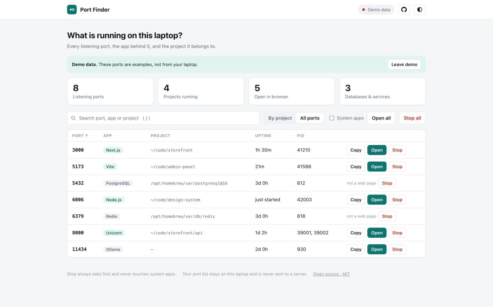
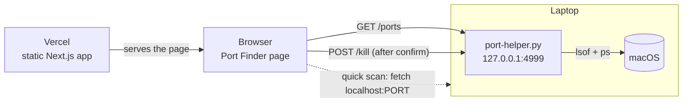

<div align="center">

# Port Finder

**See every port running on your laptop, the app behind it, and the project it belongs to.**
Stop the ones you no longer need — from your browser.

[](https://github.com/Balaji91221/port-finder/actions/workflows/ci.yml)
[](LICENSE)
[](https://nextjs.org)
[](CONTRIBUTING.md)

[**Try the demo**](https://port-finder-five.vercel.app/?demo) ·
[Open the app](https://port-finder-five.vercel.app) ·
[Report a bug](https://github.com/Balaji91221/port-finder/issues/new?template=bug_report.yml)

<picture>
  <source media="(prefers-color-scheme: dark)" srcset="docs/screenshot-dark.png">
  
</picture>

</div>

---

## Why

`lsof -i -P | grep LISTEN` tells you *that* port 3000 is taken. It does not tell you
*which of your twelve projects* is holding it. Port Finder answers that in one glance:

- **"Port 3000 is already in use"** → see that it is `storefront`, started 2 days ago, and stop it.
- **"What did I leave running?"** → every dev server, grouped by project folder.
- **"Is my database up?"** → databases and services in their own section.

## Features

| | |
|---|---|
| **Grouped by project** | Ports are grouped by the folder the process runs in, with a friendly app name: Next.js, Vite, Uvicorn, PostgreSQL, Redis, Ollama… |
| **Open & copy** | One click to open any port that serves a web page, or copy its address. |
| **Stop & Stop all** | Ends a process with SIGTERM after a confirm step. Force stop (SIGKILL) only if it is still running after 3 s. Stop all respects your search filter. |
| **Quick scan** | No install: your browser checks ~56 common dev ports for web servers. |
| **Search & sort** | Filter by port, app or folder (press `/`). Sortable table view. |
| **Live** | Optional auto-refresh every 5 s. Light and dark themes. |
| **Private** | The port list goes from your laptop to your browser. Nothing is sent to a server. |

## Quick start

1. Open **[port-finder-five.vercel.app](https://port-finder-five.vercel.app)**.
2. Pick one:
   - **Run quick scan** — works right away, shows web servers on common ports.
   - **Full details** — copy the one-line command shown on the page and run it in Terminal:

     ```sh
     curl -fsSO https://port-finder-five.vercel.app/port-helper.py \
       && python3 port-helper.py --origin https://port-finder-five.vercel.app
     ```

3. The page connects to the helper by itself within 3 seconds.

> [!NOTE]
> Full details need **macOS** and **Python 3** (preinstalled on most Macs). The helper is
> a single, dependency-free file — [read it](apps/web/public/port-helper.py) before you run it.

## How it works

A web page cannot read your ports, so Port Finder pairs the page with a tiny helper that
runs on your laptop.



- **With the helper:** the page asks `127.0.0.1:4999/ports`. The helper runs `lsof` and `ps`,
  works out the app name and project folder, and answers with JSON.
- **Without the helper:** the page tries `http://localhost:PORT` for a list of common ports.
  Any HTTP reply means "open". It cannot see app names, folders or non-web ports.

## Security

The helper can stop processes, so it is locked down:

- Listens on **`127.0.0.1` only** — other machines on your network cannot reach it.
- Answers **only the page addresses you pass with `--origin`**, and checks the `Host` header
  (blocks DNS-rebinding).
- **Stop** works only on a PID that is listening on that port *right now*, owned by you,
  and not a system app (AirPlay, macOS sharing…). It cannot stop itself.
- Every stop asks for confirmation in the page first.
- Want a list only? Start it with **`--read-only`** and every stop request is refused.

Found a security problem? See [SECURITY.md](SECURITY.md) — please do not open a public issue.

## Helper options

```text
python3 port-helper.py --origin URL [--origin URL ...] [--read-only]

--origin URL   page address allowed to read the list (repeatable)
--read-only    list ports only, never stop a process
```

`PORT_FINDER_ORIGINS=https://a.example,https://b.example` works too.

## Development

Requires Node.js 20+ and Python 3.

```sh
git clone https://github.com/Balaji91221/port-finder.git
cd port-finder
npm install
npm run dev                       # http://localhost:3000
```

In a second terminal, start the helper for your dev page:

```sh
python3 apps/web/public/port-helper.py --origin http://localhost:3000
```

| Command | What it does |
|---|---|
| `npm run dev` | Start the Next.js dev server |
| `npm run build` | Production build |
| `npm test` | Unit tests (Vitest) |
| `npm run lint` | ESLint |
| `npm run typecheck` | TypeScript, no emit |
| `npm run test:helper` | Syntax check of the Python helper |

Open `http://localhost:3000/?demo` to work on the UI with sample data.

### Project layout

```text
port-finder/
├── apps/web/                  Next.js 16 app (the page)
│   ├── app/                   layout, page, global styles
│   ├── components/            Dashboard, port lists, Stop / Stop all, connect card
│   ├── hooks/                 usePortSource (helper, quick scan, demo), useToast
│   ├── lib/                   types, reply parsing, grouping, quick scan, demo data
│   └── public/port-helper.py  the helper, served for the one-line install
├── docs/                      screenshots
└── .github/                   CI, issue and PR templates
```

### Deploy your own

1. Fork this repo and import it in [Vercel](https://vercel.com/new).
2. Set **Root Directory** to `apps/web`. The framework is detected as Next.js.
3. Run the helper with `--origin https://your-site.vercel.app`.

## Roadmap

- [x] Next.js app with project grouping, quick scan and demo
- [x] Stop and Stop all with confirm and Force stop
- [ ] `npx` CLI in Node.js — no Python needed
- [ ] Linux support (`ss` instead of `lsof`)
- [ ] Windows support
- [ ] Publish to npm

Ideas and votes welcome in [Issues](https://github.com/Balaji91221/port-finder/issues).

## FAQ

<details>
<summary><b>Does it work in Safari or Firefox?</b></summary>

Tested in Chrome on macOS. Other browsers are untested so far; Safari often blocks an
`https` page from calling `http://127.0.0.1`. Chrome may ask to allow "local network
access" — click Allow. Reports for other browsers are welcome.
</details>

<details>
<summary><b>Quick scan found nothing, but I have servers running.</b></summary>

Quick scan checks ~56 common ports and only finds HTTP servers. Databases and custom ports
need the helper. In Chrome, allow local network access when asked, then scan again.
</details>

<details>
<summary><b>Is my data sent anywhere?</b></summary>

No. The page is static. The port list travels from the helper on your laptop straight to
your browser tab. There is no backend, analytics or tracking.
</details>

<details>
<summary><b>Can someone else stop my processes?</b></summary>

Not remotely: the helper only listens on `127.0.0.1` and only answers the origins you list.
Run it with `--read-only` if you never want stopping.
</details>

## Contributing

Contributions are welcome — bug reports, app-name rules for more frameworks, docs and code.
Read [CONTRIBUTING.md](CONTRIBUTING.md) to get started, and please follow the
[Code of Conduct](CODE_OF_CONDUCT.md).

## License

[MIT](LICENSE) © Balaji91221
